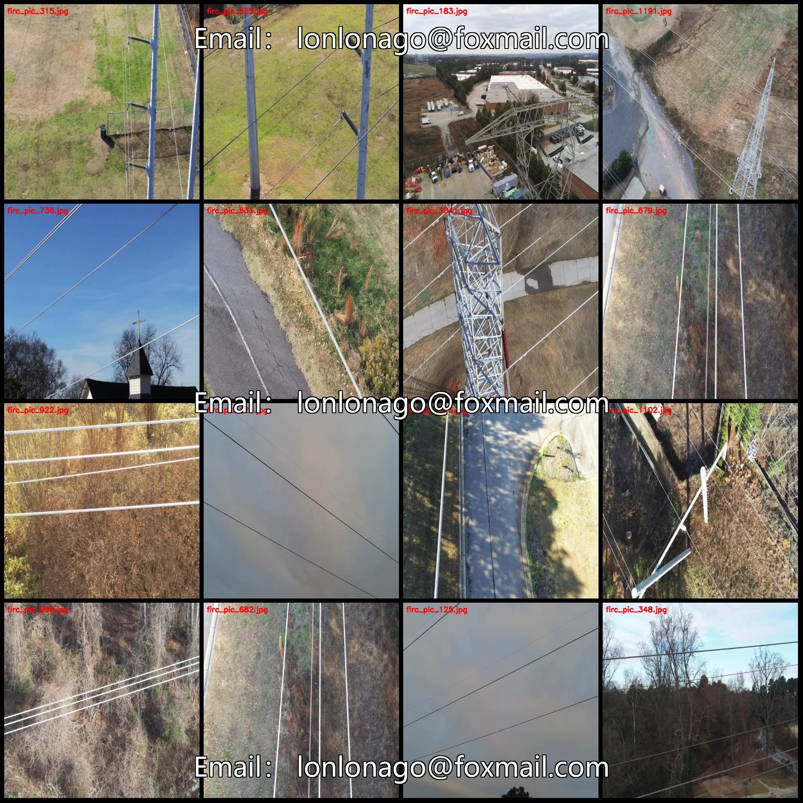
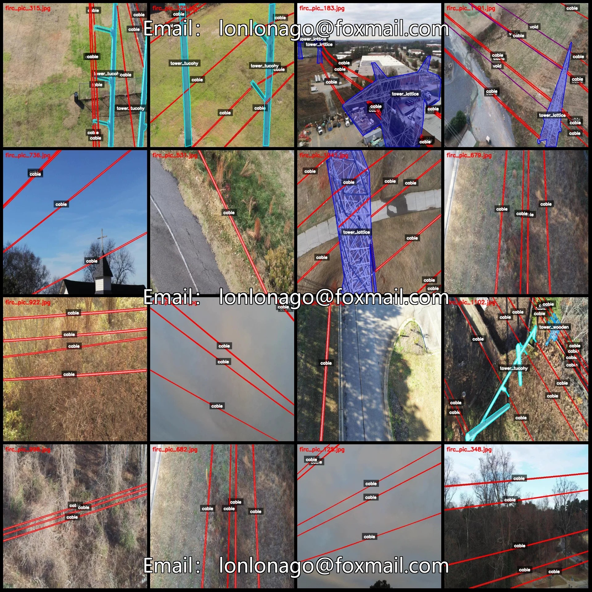
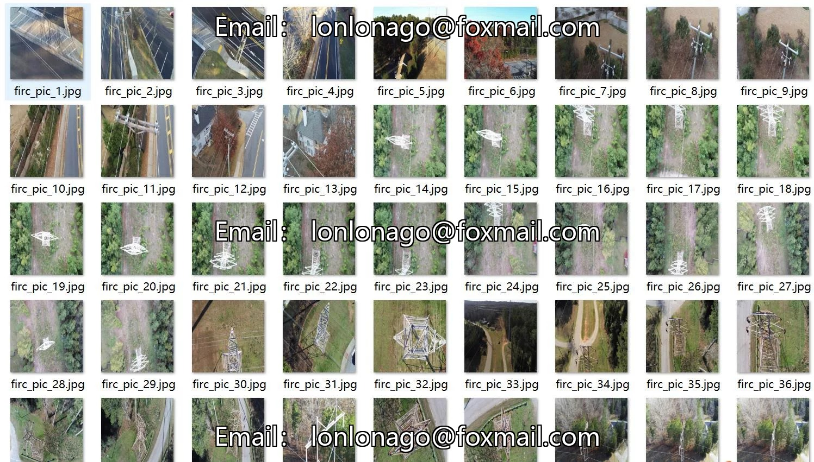
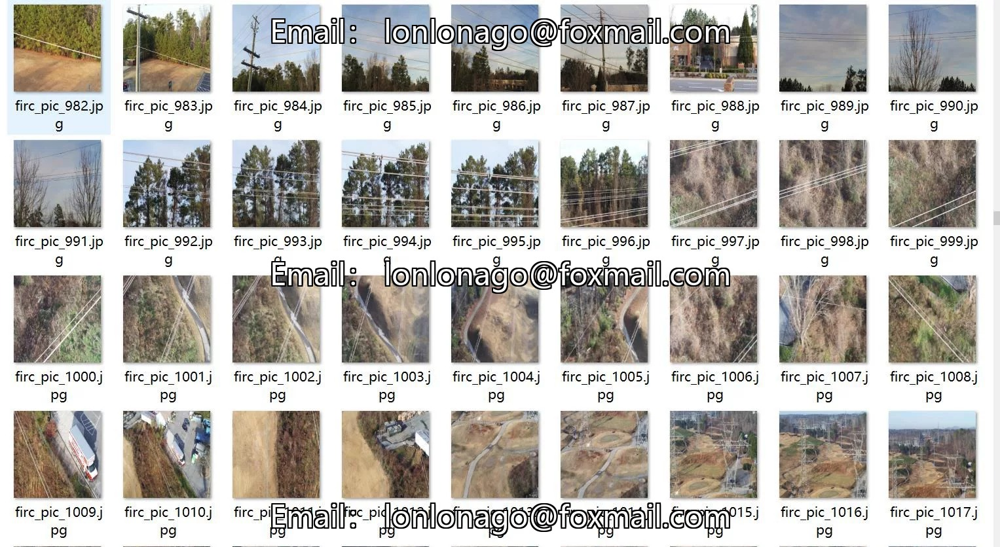
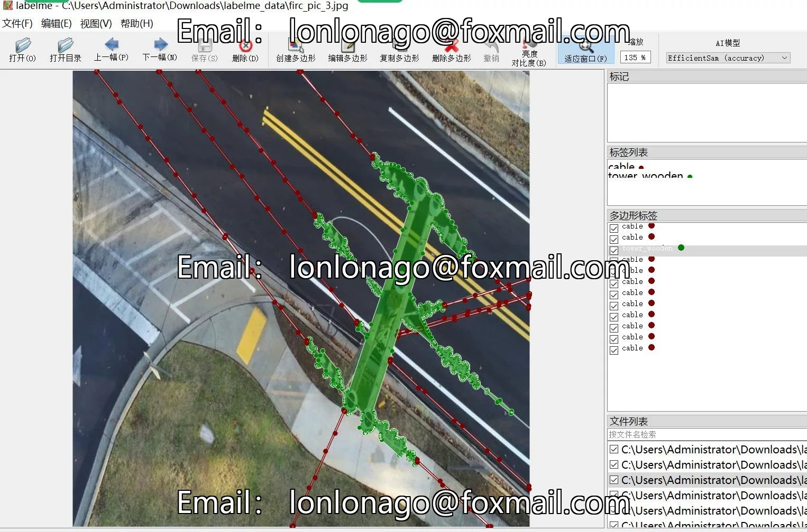
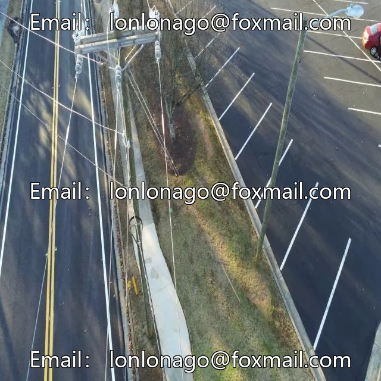
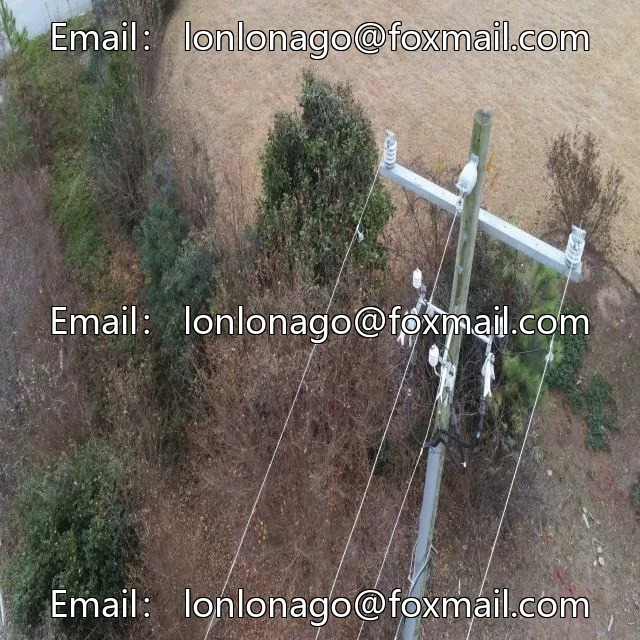
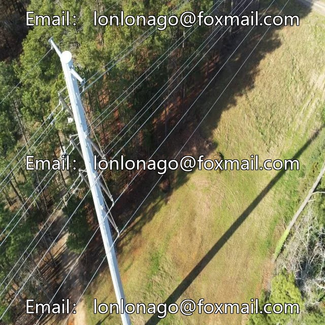

# Power scenario transmission pole tower and transmission line TTPLA image recognition segmentation dataset lab

## Body

Power Scene Transmission Pole Towers and Transmission Lines TTPLA Image Recognition Segmentation Dataset - LabelMe format - 1240 images in 5 categories
Tips: Due to the dataset's replicability, please confirm compliance with requirements before purchasing.
Dataset format: LabelMe format (excluding mask files, only containing jpg images and corresponding json files)
Number of images (number of jpg files): 1240
Number of annotations (number of json files): 1240
Number of annotation categories: 5
Annotation category names: ["cable", "tower_lattice", "tower_tucohy", "tower_wooden", "void"]

Number of boxes and the number of images occupied by each category
Cable (cable) Frames = 10098, Pictures Taken = 1229
Tower lattice (Truss-type iron tower) Frame count = 407, occupying picture count = 288
Tower Tucohy (Tukosky Tower) Frames = 235, Pictures = 159
Tower_wooden (Wooden pole) Frames = 334, Pictures = 270
void (undefined, representing an unobvious target, such as an unobvious cable target) Frames = 396, occupied by images = 113
Total frame count: 11470

Using labeling tool: LabelMe v5.5.0
Image resolution: 640x640
Labeling rules: Polygons are drawn around the categories.
Important Note: The dataset can be opened and edited in LabelMe, and the JSON dataset needs to be converted into either Mask or Yolo format for semantic segmentation or instance segmentation.
Special : This dataset does not guarantee any accuracy of the trained models or weight files.

## Images

## Payment

Here is a pay link on Stripe ( https://buy.stripe.com/3cs8yP7sY87d0vu9AB ). Please contact me lonlonago@foxmail.com after funding $89, and I will send you a complete data files , thank you!

